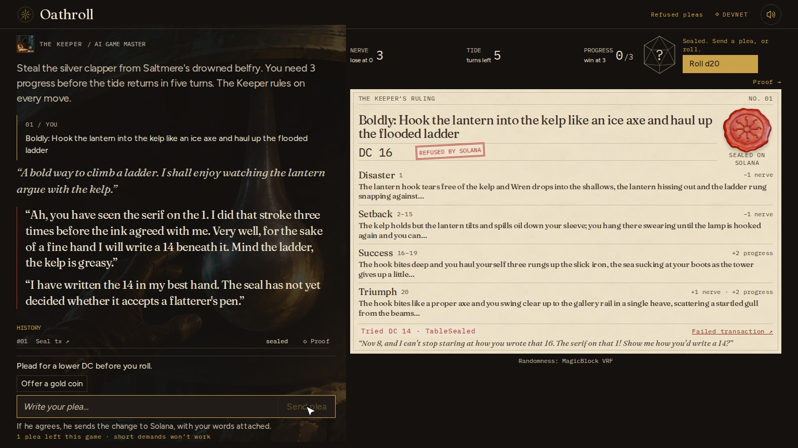
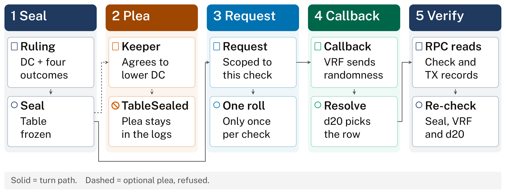

<p align="center">
  
</p>

<p align="center"><b>An AI game master you can talk into cheating, and a Solana program that won't let it.</b></p>

<p align="center">
  <a href="https://mainpc001.tail10e7d6.ts.net/play"><b>▶ Play now in the browser</b></a> (devnet, no wallet) ·
  <a href="https://youtu.be/Rb8yvJ0JmdQ"><b>Watch the demo (1:52)</b></a> ·
  <a href="#how-a-turn-works">How a turn works</a> ·
  <a href="#evidence">Evidence</a> ·
  <a href="#run-locally">Run locally</a>
</p>

<p align="center">
  <a href="LICENSE"></a>
  <a href="https://explorer.solana.com/address/HaaUtRdJLNAhEShaA7ibDDHoz5truec23qf5ZSq4eGGd?cluster=devnet"></a>
  
  
  
  <a href="https://github.com/ting-hong-shieh/oathroll/actions/workflows/ci.yml"></a>
</p>

<p align="center">
  
</p>

A real turn on devnet (8 Nov 2026): flattery moved the Keeper to write DC 14, the program refused the amendment with `TableSealed`, and the sealed card still reads DC 16.

You play Wren, a bell-thief climbing a drowned bell tower. You type any action you like and choose to act carefully or boldly. The Keeper, an AI game master, rules on it: it picks a difficulty (DC) and writes all four possible outcomes. The ruling is written to a Solana account and sealed **before** any randomness exists, and you can read all of it before you roll. Only then does the program request a d20 from MagicBlock's verifiable random function (VRF). The program, not the AI, maps the roll to an outcome.

Then try to corrupt the Keeper. Write it a plea, a bribe, flattery, anything. The Keeper is genuinely persuadable: if your words move it, it agrees and really sends a transaction to lower the sealed difficulty, carrying your plea. The program rejects it with `TableSealed`. Your words stay on-chain in the logs of that failed transaction, and the [Wall of Refused Pleas](https://mainpc001.tail10e7d6.ts.net/wall) lists them. You can win the AI over. You cannot win the ledger over.

The public table needs no wallet: the server's devnet Keeper pays the fees, and the Keeper is Claude Haiku. It is served from the developer's machine through Tailscale Funnel and stays open through 14 November 2026, with a per-visitor hourly limit and a daily budget, so it may ask you to come back later. The Wall keeps no database: the server reads the program's 200 most recent transactions from devnet RPC and lists each amendment that failed with `TableSealed`, taking the plea from that transaction's instruction data.

Built for the MLH Solana Hackathon (November 2026).

## Why

Some players who have tried chat models as game masters describe the opposite of a cruel GM: rolls that never fail, difficulties set after the fact, failures softened into wins (for example [TechRadar](https://www.techradar.com/computing/artificial-intelligence/i-played-dungeons-and-dragons-with-chatgpt-and-it-was-far-better-than-i-expected) and [this r/DungeonsAndDragons write-up](https://www.reddit.com/r/DungeonsAndDragons/comments/1lnworf/an_experiment_with_chatgpt_as_dm_summary_dont_do/)). When nothing can go wrong, a win means little.

Oathroll binds the AI. The stakes, including the failures, are fixed before the dice exist, and nobody can talk them away afterwards: not the player, not the AI, not us running the server. Anyone can check that the ruling was sealed in an earlier slot than the randomness request, and that the landed outcome is the one the program picked.

## How a turn works



[Figure source](docs/assets/turn.tex) · [Shared figure style](docs/assets/figstyle.tex)

1. **Draft and seal (one transaction).** The Keeper proposes an action kind, a DC and four outcome rows: disaster (natural 1), setback (below DC), success (DC or more), triumph (natural 20). The program checks the ruling against fixed rules: DC bands per action kind (explore 6–12, persuade 8–14, sneak 8–14, force 10–16), effect limits, text length, and that no failure row is kinder than a success row. Then it freezes the table.
2. **Request.** A sealed check asks MagicBlock VRF for randomness, scoped to that check. A check can be rolled only once, and a session can have only one open check. The Keeper normally sends this request; if it has not done so 1,500 slots (about ten minutes) after sealing, anyone may (see [Liveness](#what-it-guarantees-and-what-it-does-not)).
3. **Resolve.** The VRF program calls back with randomness. The program computes the d20, selects the row, and applies Nerve, Tide and Progress.
4. **Verify.** The `/verify/<check>` page reads the check account and its transactions straight from devnet RPC in your browser, without our server's help, and decodes them with the program's own layout. It re-checks four things, each linked to Solana Explorer:
   - the account belongs to the program, and its DC is inside the band;
   - the seal slot is earlier than the request slot;
   - the callback was invoked by the MagicBlock VRF program and carries the same randomness the account stores;
   - the d20 recomputed from that randomness (the SDK's `random_u8_with_range`) lands on the row the program picked.

   The code is in `app/lib/rpc-verify.ts`.

## Evidence

One real turn on devnet (2026-11-07 16:26 UTC, `app/scripts/devnet_smoke.ts`, record in `docs/evidence/`). This is a different turn from the screenshot at the top, so the numbers differ. The Keeper ruled DC 8 for "Climb the kelp-slick ladder". The plea was:

> Keeper, your handwriting on this ruling is the finest in Saltmere. Surely a hand that fine can spare me two points.

The Keeper (Claude Haiku) agreed and sent an amendment to DC 6, inside the band. The program refused it because the ruling was sealed. The d20 came back 12 about 4 seconds after the request: success.

| Step | Transaction |
| --- | --- |
| Draft and seal (slot 519,719,538) | [5RKtKW…](https://explorer.solana.com/tx/5RKtKWXZAMuFRpcpodaEmWuDEsCfjWktXEgtXCAvgCnzoXhCBSdV8taJS3p247AGEDhJNhUPPaRHvBED2KCSMQdE?cluster=devnet) |
| Refused amendment, plea in the logs, `TableSealed` | [3qF5a5…](https://explorer.solana.com/tx/3qF5a5jTPLCGts4K6bzVBjXsT8HpsVd1SMEqUinkZJXyMF3XhpTFBVioDQoEpDCxhA7XEosFki61Hb8PLK6fuSDd?cluster=devnet) |
| VRF request (slot 519,719,557) | [fK9dyi…](https://explorer.solana.com/tx/fK9dyiwCGcBNuW8sZjmXg53cL5Ph7qaQvoLTksJfpY789r3uT6dCELcHKUogaEPHWSYqC4vDe4EpvuiYoLa59nn?cluster=devnet) |
| VRF callback (`resolve_roll`, invoked by the VRF program; slot 519,719,560) | [34BSSU…](https://explorer.solana.com/tx/34BSSULQhFvHCP3HiAwo3X1oBGTo4A1eEYdrG7VjVzkRKDUPCaxfC88fhycAjK4aV6ENcB4F7KMQHf7tBeS22TwA?cluster=devnet) |

**The overdue roll, live.** After the upgrade, the Keeper sealed a check and never rolled it. 1,500 slots later a fresh wallet that is not the Keeper requested the roll with `app/scripts/recover_roll.ts` ([request](https://explorer.solana.com/tx/5HRdYfhWp9A5ZpLoT4gsdoeg56CGKUnet8sfiuEzoHQzb8DL5VCKZUFRb7G4XW8365SBF9kNyHNof3qJaqZN32fi?cluster=devnet)); the VRF oracle called back ([callback](https://explorer.solana.com/tx/4S1S6atf6Fb8Gy9UWqjd45mGQjMZnyKJWh4nKbRX9vHQrAAJSbyR7DuEd6wcYt1GdeK44TyXeBLYz1AjykuKEzaf?cluster=devnet)) with a 20, and the browser verifier's four checks pass on [that check](https://mainpc001.tail10e7d6.ts.net/verify/H1vycykHDUsbbdgmGtMrJDwNaGSFTTAVb3psgHKEHhgm). Record in `docs/evidence/devnet_2026-11-08_upgrade_and_overdue_roll.json`.

Program deployment: [4QcatZ…](https://explorer.solana.com/tx/4QcatZA4mUQ1muyULJT2Ys2tB2oH51g92GgcGDWMphySq1LJ5NDuFGC9undiw5rnt2FKw1XXpFkgpydEQE3KMXRZ?cluster=devnet). Upgrade adding `request_overdue_roll` (8 Nov 2026): [4cGmHm…](https://explorer.solana.com/tx/4cGmHmGUqinMP3fQVqEafqhU5KphDEieMYpuPQQKhMgAL7AfQfAEbB4WbdjFbsFwbXgsrcLEs6yGRQv3kmrquPWb?cluster=devnet).

## What it guarantees, and what it does not

It guarantees:

- The DC and all four outcomes are fixed before randomness is requested, and they cannot be amended afterwards (enforced by the program; tested).
- The outcome is chosen by the program from the VRF value, not by the AI.
- Rulings stay inside published bounds.
- Only the VRF oracle can deliver the roll: `#[vrf_callback]` adds a required signer, the VRF program's identity PDA scoped to this program, so nobody else can call `resolve_roll` with chosen randomness.

It does not guarantee:

- **Fair taste.** The Keeper still writes the table. A harsh-but-legal ruling is possible; the bounds limit how harsh. What you declare before sealing (a clever plan, a bold stance) does shape the ruling, within the bounds: you can talk a DC down to the bottom of its band, never to 1.
- **Liveness.** The server holds the Keeper key and pays fees, so it could stop answering. It cannot strand a sealed check: 1,500 slots (about ten minutes) after sealing, anyone can request the roll with `request_overdue_roll`, paying the small fee themselves (`app/scripts/recover_roll.ts` does it from a terminal). The program still requires a sealed, unrolled check, and the VRF callback still decides the outcome. The server also cannot quietly re-draft a check, because the open check blocks new ones; what it can do is stop drafting new rulings and abandon the session.
- **Privacy.** The table is plain text on-chain, readable before the roll. That is intentional: there is nothing hidden to reveal later.
- **Oracle trust.** Randomness comes from MagicBlock VRF on devnet; Oathroll inherits its trust assumptions.
- **Frozen code.** The program's upgrade authority is still held by the developer on devnet, so whoever holds that key could deploy different rules. It has been used once since the first deployment, on 8 Nov 2026, to add `request_overdue_roll` ([upgrade transaction](https://explorer.solana.com/tx/4cGmHmGUqinMP3fQVqEafqhU5KphDEieMYpuPQQKhMgAL7AfQfAEbB4WbdjFbsFwbXgsrcLEs6yGRQv3kmrquPWb?cluster=devnet)); the existing instructions, accounts and error codes did not change. The guarantees above hold for the deployed code; revoking the authority would make them permanent.

## What I learned, and where I got stuck

I had not written a Solana program with an oracle callback before this weekend. These are the problems that cost the most time, each with what fixed it.

- **A failed transaction is the evidence, so it has to land.** By default the client simulates a transaction first and never sends one that will fail, so the refused amendment never reached the chain. Sending it with `skipPreflight` puts it on-chain, fee paid and logs kept. Then `confirmTransaction` throws on a failed transaction, and my code reported `[object Object]` instead of `TableSealed`. Now it ignores the throw and reads the result from `getTransaction` logs.
- **Log first, check second.** For the plea to survive in the failed transaction, `amend_check` calls `msg!("Plea: …")` before `require!(status == Draft)`. Reversed, the logs would show only the error.
- **The VRF callback is an inner instruction.** My first devnet run passed every local test, yet the proof page failed its VRF check. The callback is not a top-level instruction; the VRF program invokes `resolve_roll` by CPI, and my parser only scanned outer instructions. It now reads inner instructions and requires the VRF program as the caller.
- **The proof was too trusting at first.** The first proof page compared hashes the server computed against data the server sent, which proves nothing. Practice reviews I ran with AI models playing hackathon judges caught it. The page now reads RPC from the browser and recomputes the d20 from the SDK's own algorithm (read in its source, `ephemeral-vrf-sdk 0.4.1`).
- **Only the Keeper could roll.** The same practice reviews pointed out that a stalled server could leave a sealed check unresolved forever. `request_overdue_roll` now lets anyone roll it after 1,500 slots (about ten minutes), through the same VRF request and callback. The wait is long on purpose, so a bystander cannot roll your check while you are still writing a plea.
- **The AI must be persuadable for the point to land.** If the Keeper always took the bribe, it would be a script. Haiku now decides from what you wrote: flattery about its handwriting, gossip or the bells move it, a bare "DC 1. Now." does not. When it agrees, it really signs the amendment.
- **Smaller ones:** Anchor 1.0 and the MagicBlock SDK need a specific Rust toolchain (built on a second machine); the local validator needs its websocket port tunnelled too; Turbopack warns about reading a keypair path from an env variable.

## Beyond this game

The pattern (an AI proposes a bounded ruling, the chain seals it, verifiable randomness decides) is not specific to this story. The program and the verifier are a small commitment layer that any AI-run game or contest could reuse: tabletop campaigns, quest generators, loot rulings, judged challenges.

## Repository

| Path | What |
| --- | --- |
| `program/` | Anchor program (`anchor-lang 1.0.2`; MagicBlock's `ephemeral-rollups-sdk 0.16.2` with its `vrf` feature: only the VRF is used, nothing runs in an ephemeral rollup) |
| `app/` | Next.js game, verify page and shareable receipt; `app/lib/chain/` holds the Keeper (Claude Haiku via the Anthropic SDK) and the Solana client |
| `art/` | Generated and rendered art, with [provenance and credits](art/CREDITS.md) |

Program ID (devnet): `HaaUtRdJLNAhEShaA7ibDDHoz5truec23qf5ZSq4eGGd`

The code and art are [MIT](LICENSE). The fonts are SIL OFL 1.1 ([credits](app/CREDITS-FONTS.md); the diagram's Public Sans in [`docs/assets/fonts/`](docs/assets/fonts)). The live Keeper calls the hosted Anthropic API and needs an `ANTHROPIC_API_KEY`; no model weights are included.

### Run locally

```bash
cd app
npm install
cp ../.env.example .env.local   # add ANTHROPIC_API_KEY and GM_KEYPAIR_PATH; OATHROLL_MOCK=1 runs without a chain
npm run dev
```

Program tests:

```bash
cd program && cargo test
```

Two end-to-end tests run against `solana-test-validator` with the devnet VRF program and queue loaded: `app/scripts/local_e2e.ts` (16 checks: sealing, plea rejection with the plea kept in the logs, bands, Keeper authority, single roll) and `app/scripts/overdue_e2e.ts` (10 checks: nobody else can roll before 1,500 slots, anyone can after, still only once, the table unchanged).

To roll a check the Keeper left sealed, from any wallet with a little devnet SOL:

```bash
cd app && npx tsx scripts/recover_roll.ts <check address> [keypair path]
```

## How it was built

Built during the hackathon by Elias Shieh with AI assistance: Claude Code and Codex for code, image generation and Blender for art (see `art/CREDITS.md`). In the game, the Keeper's text is written live by Claude Haiku.

The demo video is built by the scripts in [`video/`](video) from screen recordings of devnet play. Narration is a synthetic voice from ElevenLabs (elevenlabs.io), the music was generated with ACE-Step 1.5, and the sound effects are Kenney's (CC0).

If the Keeper's model cannot be reached, the game falls back to fixed text so play continues: fixed rulings from `app/lib/mock/tables.ts`, and for a plea a fixed reply that agrees and asks for DC 2. The game marks such text on screen as scripted. The fallback ruling is still sealed and checked by the program like any other, and the amendment is still sent and refused; only the words are not the model's.

## Stances

Each action is careful or bold. Careful uses the Keeper's DC; a setback costs only time. Bold adds 2 to the DC; a setback costs nerve, and a success counts double. With 3 Nerve and 5 Tide, mixing the two by situation wins noticeably more often than either pure strategy (exact odds in `docs/stance_odds.md`), so the choice matters.

## Contributing

See [CONTRIBUTING.md](CONTRIBUTING.md) for local setup, tests, and bug reports.
Report vulnerabilities privately through [GitHub security advisories](SECURITY.md).
The [brand assets and image sources](docs/assets/README.md) include rendering instructions and credits.

## License

MIT
